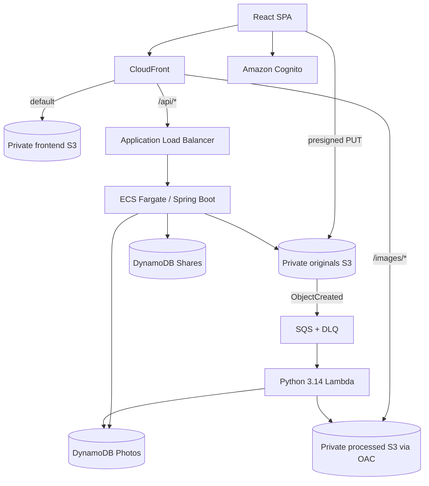

# Architecture

## Upload flow
1. User authenticates with Cognito. React obtains an access token and sends `Authorization: Bearer`.
2. Spring Security validates JWT signature/issuer. API derives owner from JWT `sub` (never a request body user ID).
3. API creates a `PENDING` DynamoDB photo record first, then creates a unique object key and returns a short-lived presigned S3 PUT URL. This ensures the async processor can update an existing item.
4. Browser uploads directly to private original S3.
5. Browser confirms; API verifies object using `HeadObject` and conditionally persists metadata.
6. S3 ObjectCreated sends notification to SQS. Lambda generates WebP renditions and writes status to DynamoDB.
7. CloudFront serves images from private processed bucket via OAC. Private viewer access still needs signed URLs/cookies or an auth proxy.

## DynamoDB access patterns
Photos: PK `photoId`; GSI `ByOwnerAndCreatedAt` with PK `userId`, SK `createdAtPhotoId`. Attributes include owner, original/thumbnail/medium keys, status, content type, size, creation time and description.

Shares: PK `shareId`; attributes photoId, ownerSub, expiry, revoked, createdAt and TTL epoch. TTL is eventual cleanup only; enforce expiration synchronously on every read.

## Design choices
Spring Boot runs on ECS Fargate because the user wants a conventional long-running REST API. Lambda handles asynchronous image processing. SQS buffers events and provides retries/DLQ. DynamoDB avoids operating a relational database in this serverless-oriented first iteration. CloudFront routes static UI, API and images separately. Disable caching for `/api/*` and ensure no user-specific response can enter a shared cache.
